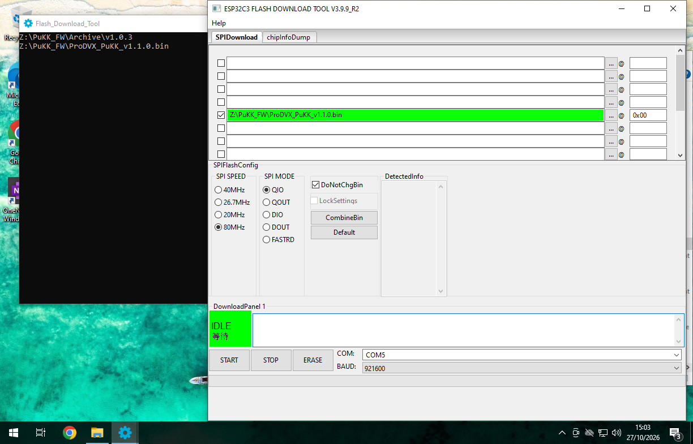

# PuKK Migration guide (from v1.0.3 to v1.1.0)

Due to modifications to the firmware, some changes are required to update the PuKK to a new version.
Please note that if there is a **BLUE MARK** next to the `1.0.3_Burn` firmware on the product box, the device is already updated to 1.1.0!

## Configuration changes
A few changes were made to the configuration. Most notably:

- `cms_server_address` -> `http_server_address`
- `do_ota` -> `enable_ota`
- `poll_interval_ms` -> `http_poll_interval_ms`

## REST API Authorization
From v1.1.0, a bearer token is required for the on-device REST API. This is required for all endpoints.

This token is generated from the <a href="https://promgr.prodvx.com/cloud/proDvxApi">Token Generator</a> on the ProMGR Portal with the default device key `ProdvxPukk`.

## Firmware Upgrade
Due to a core modification in the firmware, a manual upgrade is required.

The standard guide uses a Windows PC. Similar methods are possible with other systems. Request more information with ProDVX Support.

### Tools required
- Windows PC
- Flash Download Tool ([link](https://www.dropbox.com/scl/fi/7pce4l6bomt78ugwnwq58/flash_download_tool.zip?rlkey=ffo577eu69dlspdu0llre8073&st=u4hsieko&dl=0))
- Firmware ProDVX_PuKK_v1.1.0 ([link](https://www.dropbox.com/scl/fi/h3dxh21jf87syof9l3knw/ProDVX_PuKK_v1.1.0.bin?rlkey=j2p1ru1vnox24umqsm1zfn6ih&st=pcz4pgt1&dl=0))

### Update Steps
1. Connect the PuKK Workspace to the Windows PC using a USB cable
2. Open the Flash Download Tool
3. Select the following values
	- `Chip Type`: `ESP32-C3`
	- `Work Mode`: `Develop`
	- `Load Mode`: `UART`
4. Under SPI Flash Config set the following values
	- `SPI SPEED`: `80MHz`
	- `SPI MODE`: `QIO`
5. Verify the COM port is set
6. Set `BAUD` to `921600`
7. Leave all other values default
8. In one of the boxes in the top, press the little box with the 3 dots and select the firmware (.bin) file
9. To the right of the selected firmware file enter `0x00` so it says `firmware.bin @ 0x00`
10. Ensure the firmware file is checked to the left
11. Verify if it is similar to the image below (COM port might be different in your case)
12. Press START
13. The program will change the bottom-left box (DownloadPanel) to `SYNC`, then `DOWNLOAD`, and finally `FINISH`
14. Once the DownloadPanel says `FINISH` and has turned blue, press STOP.
14. The PuKK Workspace is now updated and can be disconnected.

